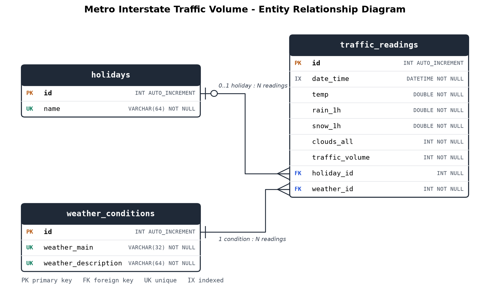
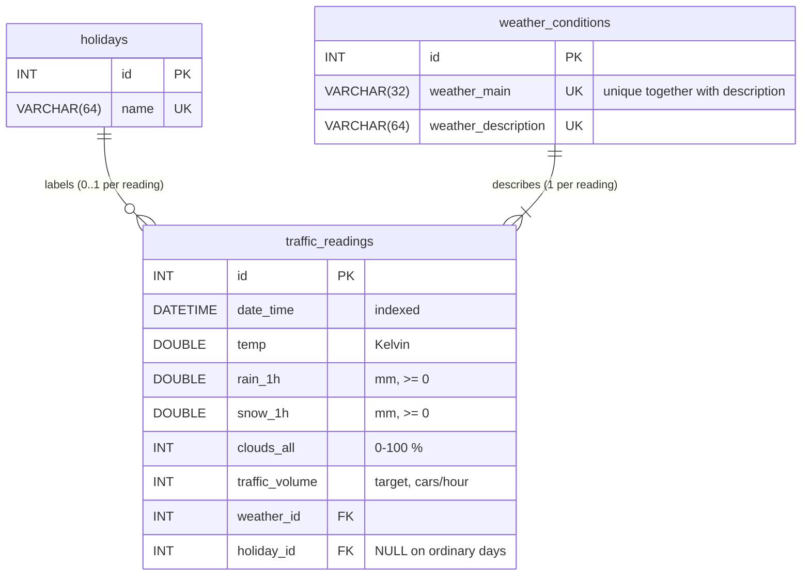

# Entity Relationship Diagram

`erd.png` is generated by `python ERD/draw_erd.py`. The same model in Mermaid (GitHub renders it):

## Design decisions

| Decision | Why |
|---|---|
| **Fact table + 2 lookup tables (3NF)** | `holiday`, `weather_main` and `weather_description` are repeated text in every CSV row. Moving them to lookup tables removes the repetition (48k rows point at 37 weather rows and 11 holiday rows). The unique key also catches spelling variants: the source has both `"sky is clear"` and `"Sky is Clear"`, which the loader merges by lower-casing descriptions. |
| **`weather_conditions` keyed on (main, description)** | The description is a sub-type of the main category (`Rain` -> `light rain`, `heavy intensity rain`, ...), so the pair is the real entity. A `UNIQUE (weather_main, weather_description)` constraint enforces it. |
| **`holiday_id` is nullable** | Most hours are not holidays; NULL means "ordinary day". Deleting a holiday sets its readings to NULL (`ON DELETE SET NULL`), while deleting a weather condition that is still in use is blocked (`ON DELETE RESTRICT`). |
| **`date_time` indexed but not unique** | The source reports one row per weather condition in an hour (e.g. `Rain` and `Mist` at the same hour, same traffic volume). Keeping those rows preserves the weather detail; time-based queries collapse them with `GROUP BY date_time`. The index serves "latest record" and date-range queries. |
| **CHECK constraints** | Rain/snow/volume can't be negative and cloud cover is a percentage. |
| **`v_readings` view** | Rebuilds the flat CSV shape with joins, for analysis and the forecast script. |
